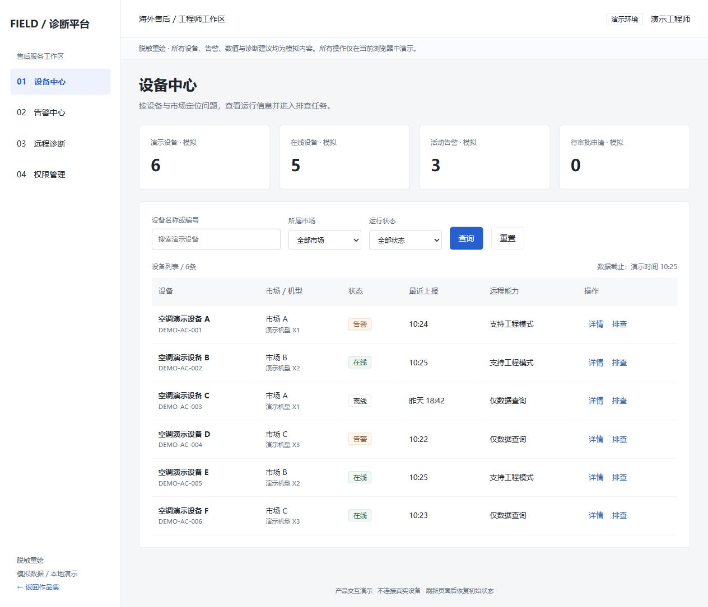
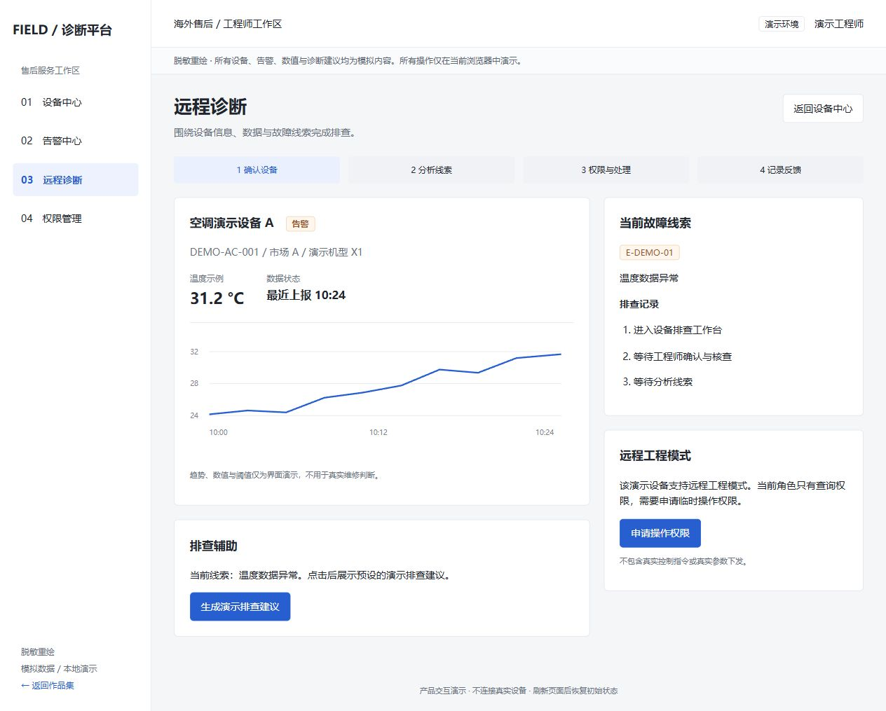

# 孙泽恺 产品作品集

围绕海外售后远程诊断业务整理的案例文档与交互原型。

## 内容导航

- [阅读项目案例 PDF](case-studies/overseas-service-platform.pdf)
- [作品集首页](index.html)
- [交互原型源文件](prototype/)
- [设计说明与参考](design-notes/README.md)

## 分类

```text
product-portfolio/
├── index.html                  作品集入口
├── case-studies/
│   └── overseas-service-platform.pdf  已审阅案例
├── prototype/
│   ├── index.html              诊断平台原型
│   ├── style.css               页面样式
│   └── app.js                  模拟数据与交互
└── design-notes/
    └── README.md               页面设计说明
```

## 演示路径

1. 打开作品集首页，进入交互原型。
2. 在设备中心筛选设备，查看详情或点击排查。
3. 在告警中心确认告警并进入相应设备。
4. 生成预设排查建议，记录演示反馈。
5. 申请临时远程操作权限，在权限管理中查看待审批记录。

## 本地查看与 GitHub Pages

无需安装依赖，直接打开 `index.html` 即可查看。也可用任意静态 HTTP 服务预览。

仓库发布到 GitHub 后，可在 Settings → Pages 中选择从分支部署，以主分支的根目录为发布目录。仓库地址便于查看文档与代码，Pages 地址便于直接体验原型。

## 作品范围

所有流程与页面均为**脱敏重绘**。案例 PDF 来自已审阅项目文档；网页是基于业务经验重新设计的公开演示，不代表美的内部页面、真实权限矩阵或所有已上线功能。设备、告警、时间、数值与知识条目均为**模拟数据**。

原型不连接真实设备、企业服务或大模型，不发送控制命令。临时申请和操作记录只保留在页面内存中，刷新后清空。前端权限说明用于演示产品规则，不构成真实访问控制。

## 作者与实现

作者：孙泽恺。业务材料与产品方案由作者整理，本次公开展示版页面实现使用 AI 辅助。设计参考见 `design-notes/README.md`。

## 页面预览

### 设备中心



### 远程诊断


